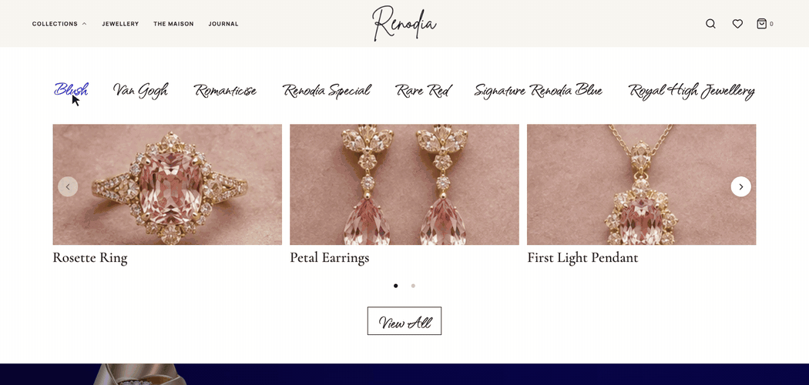

# Renodia Diamonds | Storefront Rebuild

I first worked on Renodia Diamonds as a freelance web developer from December 2024 to March 2025. That project was a WordPress website built to showcase the brand’s jewellery collections. My work covered the responsive design, on-page SEO, analytics setup, and the product inquiry flow.

This repository is a separate portfolio rebuild in Next.js. I wanted to keep the details that made Renodia recognizable, especially the handwritten wordmark, the indigo opening, and the seven collections. The biggest design change is how people discover pieces. Hover over **Collections**, then move across the handwritten names to preview each collection’s jewellery without leaving the page.

[Open the live demo on GitHub Pages](https://nihal0801.github.io/renodia/) · [Visit the original WordPress site](https://renodia.ascassy.com/)



[See the full homepage](artifacts/01-desktop-home.png)

## What to try

- Hover over **Collections** on desktop, switch between collections, and use the arrows to see more pieces. The menu also works with the keyboard. On mobile, use the navigation drawer.
- Explore the collection index, filter the catalogue, and open a product to see its detail image.
- Search for a piece, save it to your wishlist, or add it to the bag. The wishlist and bag are saved in your browser.

[Collections dropdown](artifacts/03-desktop-collections-menu.png) · [Product preview](artifacts/04-desktop-product-hover.png) · [Product page](artifacts/06-desktop-product.png) · [Mobile homepage](artifacts/07-mobile-home.png) · [All screenshots](artifacts/)

## Run it locally

Use Node.js 22 or newer.

```sh
npm ci
npm run dev
```

Open [localhost:3000](http://localhost:3000). The project uses Next.js, React, TypeScript, and CSS. The catalogue lives in [data/catalogue.ts](data/catalogue.ts).

```sh
npm run lint
npm run typecheck
npm run build
npx playwright install chromium
npm test
```

Playwright checks the dropdown, catalogue, shopping flows, and six viewport sizes. The screenshot suite writes its captures to `artifacts/`.

## About the demo

The catalogue contains 28 illustrative products with sample prices. Checkout shows an order summary, and the newsletter form validates input locally. The original Renodia site supplied the wordmark, indigo backdrop, and silver ring. The other product and campaign images were created for the rebuild. Font licenses are in [public/fonts](public/fonts/).
